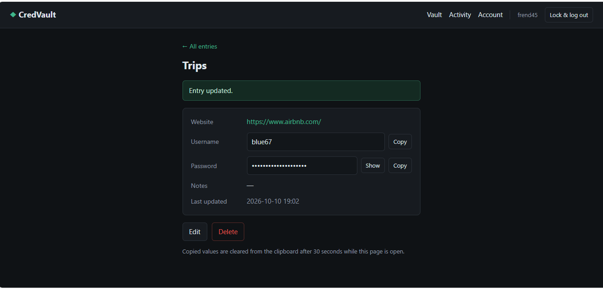
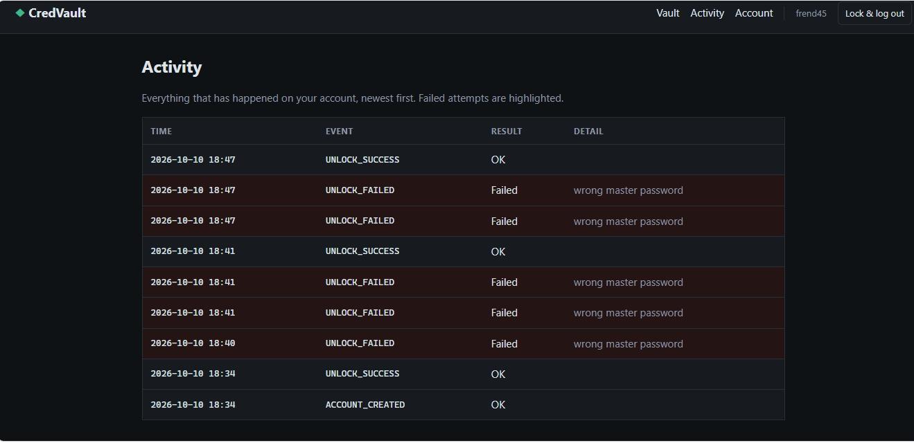

# CredVault

[](https://github.com/Jody2905/credvault/actions/workflows/ci.yml)


**A multi-user password vault built with Java, Spring Boot, Spring Security and PostgreSQL.** Each user's credentials are encrypted with AES-256-GCM under a key that only their master password can unlock. The server never stores the master password or even a hash of it, so a stolen database contains nothing readable.



---

## Security design

### Envelope encryption

```
master password ──PBKDF2-HMAC-SHA256 (600,000 iterations)──▶ key-encryption key
                                                                   │ unwraps
                                                                   ▼
                                                        data key (random AES-256)
                                                                   │ encrypts
                                                                   ▼
                                               each entry's username, password, notes
```

- **No password hash is stored.** Logging in means proving the master password can unwrap the data key. An attacker with the database must guess each master password at 600,000 PBKDF2 rounds per guess.
- **AES-256-GCM (authenticated encryption)** with a fresh random IV for every value, so tampering is detected, not just hidden.
- **Ciphertext is bound to its row.** Each encrypted field carries its entry ID, owner ID and field name as additional authenticated data. Copying one user's encrypted password into another row makes it fail to decrypt, and the attempt is logged as `INTEGRITY_FAILURE`.
- **Changing the master password is instant.** Only the data key is re-wrapped; entries don't need re-encrypting.
- **Crypto agility.** Stored values are versioned (`v1:...`), and each user's iteration count is stored, so algorithms and work factors can be upgraded without breaking old accounts.
- Only NIST-approved algorithms from the Java standard library; no third-party crypto.
- **Trade-off by design: there is no password reset.** Nobody, including administrators, can decrypt a vault without its master password.

### Web and access control
| Threat | Defence |
|---|---|
| Accessing another user's entry by changing the URL (IDOR) | Ownership is enforced in the query itself (`WHERE id = ? AND owner_id = ?`); someone else's entry looks identical to one that doesn't exist, and the attempt is logged as `ACCESS_DENIED` |
| Password guessing | 5 failures in 15 minutes locks the username for 15 minutes, for real and non-existent usernames alike |
| Username enumeration | Wrong password and unknown user give the same message after the same amount of work |
| Cross-site request forgery | CSRF tokens on every form, including logout; `SameSite=Strict` session cookie |
| Cross-site scripting | Thymeleaf auto-escaping, plus a strict Content Security Policy with no inline scripts |
| Session hijacking | New session ID at login; logout destroys the session and the unlocked key; 15-minute idle timeout; `HttpOnly` cookie; sessions never written to disk |
| Clickjacking, caching, referrer leaks | `X-Frame-Options: DENY`, `Cache-Control: no-store`, `Referrer-Policy: no-referrer` |
| Information leakage in errors | No stack traces or internal messages are ever shown |
| Secrets in logs | Session, form and entry objects mask secrets in `toString()`; the audit log never stores a secret (a test checks this) |

### Audit trail
Every login, failed login, lockout, view, change, deletion and access violation is recorded in an **append-only** audit table (`@Immutable`, no update path). Failed operations are still recorded even though the operation itself rolls back, because audit writes run in their own transaction. Users can review their own history on the Activity page.



---

## Testing

**55 automated tests**, run by GitHub Actions on every push:

| Suite | Tests | Covers |
|---|---|---|
| `CryptoServiceTest` | 16 | Round trips, wrong keys, single-bit tampering, row swapping, salts, encoding |
| `VaultServiceTest` | 19 | Accounts, ownership, plaintext never stored, integrity failures, password changes, audit contents |
| `LoginAttemptServiceTest` | 8 | Lockout thresholds and expiry, using a controllable clock |
| `WebSecurityTest` | 11 | Starts the real server and attacks it over HTTP: IDOR, missing CSRF tokens, brute force, session fixation, reuse of a stolen cookie after logout, XSS, security headers, username enumeration |
| `CredvaultApplicationTests` | 1 | Application starts |

A second CI job starts the packaged application against a real **PostgreSQL** database to confirm the production profile works.

```bash
./mvnw test        # Windows: .\mvnw.cmd test
```

---

## Running it

**Requirements:** Java 17 or newer. Maven is included via the wrapper.

### Development (H2 database in `./data`)
```bash
./mvnw spring-boot:run        # Windows: .\mvnw.cmd spring-boot:run
```
Open http://localhost:8080 and create an account.

### With PostgreSQL in Docker
```bash
cp .env.example .env          # then set a strong DB_PASSWORD in .env
docker compose up --build
```
The app runs as a non-root user in a minimal runtime image. The database has no published port, so only the app can reach it.

---

## Project structure

```
src/main/java/com/jody/credvault/
├── crypto/       CryptoService (PBKDF2, AES-GCM, key wrapping), EncryptedData
├── model/        JPA entities: AppUser, VaultEntry, AuditEvent
├── repository/   Spring Data repositories (ownership-scoped queries)
├── service/      VaultService (all security rules), AuditService
├── security/     Spring Security config, login provider, brute-force lockout
└── web/          Controllers for the Thymeleaf pages
```

## Possible extensions
- Argon2id key derivation (memory-hard, stronger against GPU cracking)
- TOTP two-factor authentication
- Admin role with an organisation-wide audit view
- Database migrations with Flyway
- Shared vaults between users, using per-user wrapped copies of a shared key

---

## Author

**Jody-Ann Trimmingham**, B.S. Computer Networks and Cybersecurity
GitHub: [@Jody2905](https://github.com/Jody2905)
